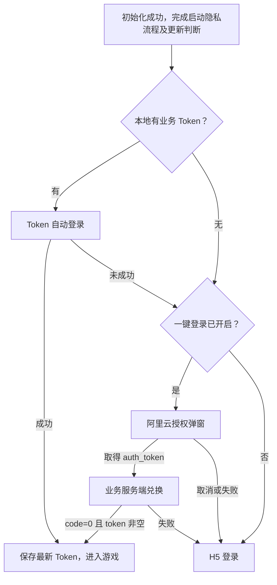
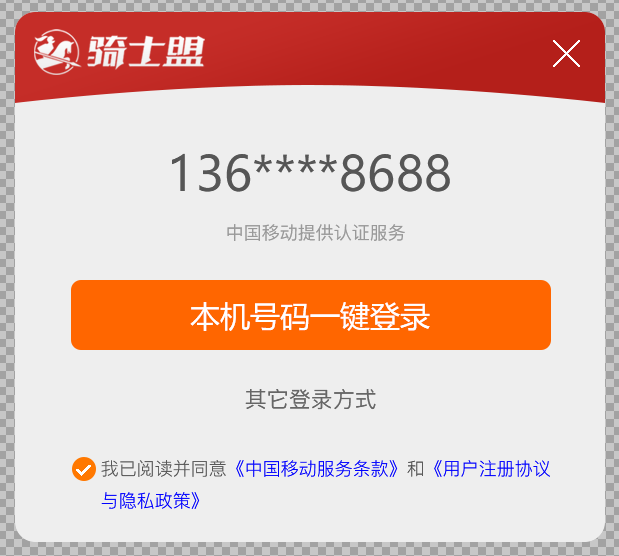

# 阿里云一键登录独立需求

更新日期：2026-10-29；版本：v1.2。适用对象：Android、iOS 原生开发、H5 开发、服务端及测试。

本文集中定义一键登录的业务流程、接口、界面和验收要求，可供 iOS 独立参考。已包含标题栏增高 15%、登录按钮字号缩小、说明文字可切换勾选及 Bridge 仅负责唤起的最新调整。Android 当前实现用于说明既有行为，不代表 iOS 已接入或已完成真机验收。

## 1. 目标与职责

- 原生集成阿里云号码认证 SDK，展示运营商授权弹窗，取得临时认证凭证 `auth_token`。
- 原生把 `auth_token` 提交给业务服务端，兑换业务登录令牌 `accountToken`；只有兑换成功才算游戏登录成功。
- H5 通过统一 Bridge 查询登录信息或请求再次唤起授权，无需接收阿里云方案密钥或临时认证凭证。
- 一键登录取消、不可用或失败时，继续 H5 登录，不能卡住游戏启动流程。

| 名称 | 含义与来源 | 用途 |
| --- | --- | --- |
| `scheme_secret` | 初始化接口下发的阿里云认证方案密钥 | 传给对应平台的号码认证 SDK |
| `auth_token` | 阿里云 SDK 返回的临时认证凭证 | 仅用于服务端兑换，不能当作业务 Token 保存 |
| `accountToken` | 业务服务端返回的登录令牌，本地字段名 | 安全持久化、原生请求及游戏 H5 使用 |
| `data.token` | 登录兑换响应中的业务 Token 字段 | 成功后保存为本地 `accountToken` |
| `gameVersion` | 出包时指定的游戏版本常量 | 请求 Header `Gameversion`；不能由服务端更新版本字段覆盖 |

## 2. 登录顺序和触发条件

### 2.1 启动自动登录

1. 调用初始化接口并取得有效配置。初始化 `code!=0` 时停止启动，显示“游戏初始化失败：”加服务端 `msg`，不进入登录。
2. 完成应用启动隐私流程及更新判断，再进入登录流程。
3. 本地有非空 `accountToken` 时，优先调用 Token 自动登录接口；成功则进入游戏，不再展示一键登录。
4. 本地无 Token 或自动登录未成功，且 `aliyunOnekeyConfig.open=1` 时，尝试阿里云一键登录。
5. 一键登录关闭、配置不足、环境不可用、用户取消或认证/兑换失败时，打开初始化返回的 `h5Pages.login`（实例 `web_login`）。
6. 任一方式登录成功后，先安全保存业务 Token，再打开 `h5Pages.game`（实例 `web_game`），销毁已存在的 `web_login`。



### 2.2 两种隐私状态分别处理

- **启动隐私状态：** 本地已同意时跳过启动隐私页；未同意且 `privacyAuto=true` 时展示 `h5Pages.agreement`，同意后继续；`privacyAuto=false` 沿用当前业务约定，跳过页面并本地标记已同意。明确拒绝后停止当前启动流程。
- **认证弹窗勾选状态：** 每次展示授权弹窗时协议默认未勾选；启动隐私已同意，不等于自动勾选运营商及认证协议。
- 未完成启动隐私流程时，不启动号码认证。弹窗内未勾选协议时，点击登录不能直接取得认证凭证或触发业务兑换，由 SDK 执行协议提示/确认。

### 2.3 H5 主动唤起

H5 登录页可以调用 `requestPhoneLogin` 再次尝试；仍受 `open` 和启动隐私状态限制。唤起失败时保留当前 H5 登录页；授权弹窗成功展示后，先完成 Bridge 成功回调，再关闭 H5 登录窗口。此后取消、切换登录方式或认证失败，由原生创建新的 H5 登录页，不能重复叠加登录页面。

### 2.4 退出登录后重新认证

`logout` 清除本地持久化业务 Token，关闭游戏、福利大厅和运营弹窗等当前会话页面并隐藏悬浮球，然后直接回到第 2.1 节的一键登录分支：`open=1` 时尝试阿里云授权；未开启、配置不足、取消、SDK/兑换失败时打开新的 H5 登录页。认证成功保存新业务 Token 并创建新游戏实例。退出后不调用旧 Token 自动登录，不重跑初始化、启动隐私页或更新检查；通用本地存储和隐私同意状态保留。Bridge 退出成功仅表示退出流程受理，不代表重新登录成功。

## 3. 初始化配置

固定初始化接口：`POST https://box.74meng.com/h5_app/init`；请求体为 `{}`。下列对象位于响应 `data.aliyunOnekeyConfig` 中，示例值不代表生产环境固定配置。

```json
{
  "open": 1,
  "config": {
    "screen_code": 1,
    "scheme_secret": "由服务端下发当前平台的认证方案密钥",
    "exchange_url": "https://box.74meng.com/h5_app/login_by_onekey",
    "launch_total_timeout_ms": 5000,
    "launch_attempt_timeout_ms": 2000,
    "launch_max_attempts": 2,
    "launch_retry_interval_ms": 500,
    "app_protocols": [
      {"name": "《用户协议》", "url": "https://box.74meng.com/h5_app/privacy?sid=1&gid=266"},
      {"name": "《隐私政策》", "url": "https://box.74meng.com/h5_app/privacy?sid=1&gid=266"}
    ],
    "ui": {
      "title": "手机快捷登录",
      "login_text": "手机号一键登录",
      "other_login_text": "使用其他方式登录",
      "primary_color": "#CC0000",
      "dialog_width_percent": 60,
      "dialog_height_percent": 75
    }
  }
}
```

以下除 `open` 外的路径均相对于 `config`。

| 字段 | 类型 | 规则与缺失时的处理 |
| --- | --- | --- |
| `open` | number | `1` 开启；`0`、缺失或未开启时跳过，不能被 H5 绕过 |
| `scheme_secret` | string | 当前平台的有效方案密钥；缺失或空白时不启动认证，回退 H5 |
| `exchange_url` | string | 完整兑换地址；不能写死示例路径；缺失或空白时回退 H5 |
| `screen_code` | number | `1` 横屏弹窗，`2` 竖屏弹窗；缺失默认 `1` |
| `launch_total_timeout_ms` | number | SDK 取认证凭证的总超时，单位毫秒；缺失默认 `5000` |
| `launch_attempt_timeout_ms` | number | 当前 Android 未解析、未实现单次超时控制；不能认为已生效 |
| `launch_max_attempts` | number | 当前 Android 未解析、未实现自动重试次数；不能认为已生效 |
| `launch_retry_interval_ms` | number | 当前 Android 未解析、未实现自动重试间隔；不能认为已生效 |
| `app_protocols` | object[] | 业务协议，`name` 为链接文字、`url` 为地址；当前 Android 最多展示前两项，缺失为空；运营商协议由 SDK 提供 |
| `ui.dialog_width_percent` | number | 弹窗宽度百分比；缺失默认 `60`，数值限制在 `1～100` |
| `ui.dialog_height_percent` | number | 弹窗高度百分比；缺失默认 `75`，数值限制在 `1～100` |
| `ui.login_text` | string | 登录按钮文字；缺失默认“手机号一键登录” |
| `ui.other_login_text` | string | 切换登录方式文字；缺失默认“使用其他方式登录” |
| `ui.title` | string | 兼容保留，但界面忽略，不能显示默认文字标题 |
| `ui.primary_color` | string | 兼容保留；当前已确认样式使用本文固定颜色，不用该字段覆盖头部或按钮 |

字段类型错误不能直接带入 SDK 引发崩溃。重试相关三个字段属于未生效配置；iOS 若需实现额外重试策略，应先与服务端和产品确认，不能仅按示例自行启用。

## 4. 业务接口与登录状态

### 4.1 请求 Header

初始化、Token 自动登录和一键登录兑换请求均由原生附加以下六项 Header；无可用值也保留字段，值为空字符串。Header 名称大小写不敏感，按下列拼写发送。

| Header | 来源 |
| --- | --- |
| `Gameid` | 当前游戏的构建配置 `gameId` |
| `Gameversion` | 当前实际安装包的构建常量 `gameVersion`，例如 `1.0.1` |
| `Packagecode` | 当前包的渠道码，未获取时为空；iOS 渠道来源需单独确认 |
| `Devicetype` | Android 为 `android`；iOS 的枚举值需与服务端确认，不复制 Android 值 |
| `Devicecode` | 本地设备码，未完成启动隐私同意前为空；iOS 生成和保存规则需单独确认 |
| `Accountoken` | 请求时从安全存储读取的最新业务 Token，未登录为空；初始化发生于隐私同意前时为空 |

注意现有协议拼写为 **`Accountoken`**，不是 `AccountToken`。`Gameversion` 不能使用 SDK 版本、服务端目标更新版本或旧包缓存值。

### 4.2 兑换阿里云认证凭证

- 方法：`POST`，地址取 `config.exchange_url`。
- `Content-Type: application/json; charset=utf-8`。
- 请求体：

```json
{"auth_token":"阿里云SDK返回的临时认证凭证"}
```

成功响应：

```json
{"code":0,"msg":"登录成功","data":{"token":"业务登录令牌"}}
```

成功必须同时满足 `code=0` 和 `data.token` 为非空白字符串。原生保存 `data.token` 为 `accountToken` 后才能通知成功、进入游戏。仅取得 `auth_token` 不算登录成功。

非 `0` 业务码、网络失败、无法解析响应，或 `code=0` 但 Token 缺失/为空/类型错误，都按兑换失败处理：不保存响应中的无效 Token、不进入游戏，回退 H5。临时认证凭证不作长期存储、不交给 H5。

### 4.3 已有业务 Token 的自动登录

- 地址：`POST https://box.74meng.com/h5_app/login_by_token`，请求体 `{}`；`Accountoken` 携带本地业务 Token。
- `code=0` 且 `data.token` 有效：覆盖保存最新 Token，进入游戏。
- 任意 `code!=0`：清除本地 Token 并完成持久化，再继续一键登录/H5；后续 Header 和 Bridge 读取为空。期间未重新登录成功时，重启不应再次请求该旧 Token。
- 网络异常或未取得有效业务响应：保留旧 Token，继续后续登录方式。
- `code=0` 但缺少有效 Token：不算成功，继续后续登录方式。

旧 Token 清理的上述规则针对 Token 自动登录接口；不能把任意网络异常等同于业务 Token 失效。

## 5. 授权弹窗视觉规范

### 5.1 参考图与资源

以下为用户提供的视觉参考；**标题栏以本节增加 15% 后的尺寸为准**，不按参考图原高度实现。参考图中的号码及运营商文案仅为示意，正式页面由 SDK 返回。



- 品牌 Logo：[box_logo.png](assets/onekey-login/box_logo.png)，原始尺寸 `210×70`，透明底白色图形，保持比例，不改用游戏桌面图标。
- 本文中的尺寸为逻辑尺寸：Android 使用 dp，iOS 以 pt 对齐视觉比例；不能直接把截图物理像素当作布局单位。

### 5.2 窗口、遮罩及方向

| 项目 | 要求 |
| --- | --- |
| 展示形式 | 居中弹窗，不能显示成黑色或透明的全屏授权界面 |
| 宽度 | 当前授权方向可用窗口宽度 × `dialog_width_percent / 100` |
| 高度 | 当前授权方向可用窗口高度 × `dialog_height_percent / 100` |
| 底层遮罩 | `#000000`，alpha 为 `0.45`（45% 不透明度） |
| 弹窗底色 | `#eeeeee`，不透明 |
| 圆角 | 14 个逻辑单位，头部上角与弹窗上角一致 |
| 打开/关闭 | 约 200ms 淡入/淡出；不阻断成功或失败回调 |

宽高比例应各自生效，不另设固定弹窗宽高覆盖接口。视口以授权页所在的当前窗口和屏幕方向为基准；Android 当前使用沉浸式窗口。iOS 应处理刘海、灵动岛及底部手势安全区域，保证内容和关闭按钮可见可点，具体安全区域基准在 iOS 联调前确认。

### 5.3 品牌头部与关闭按钮

- 头部底色 `#c52d28`，底边为浅弧，中央向上收起，两侧略向下延伸，参考上图。
- 最新总高度 **43.7**，包含弧形部分：由原来的 `38 × 1.15` 得到。红色主体参考高度 **34.5**，由原来的 `30 × 1.15` 得到。
- Logo 放左侧，左距约 `10`；当前 Android 以 `90×30` 容器等比居中显示。Logo 不随标题栏拉伸变形。
- 右侧使用白色“×”关闭图标；图标右边距约 `10`，位于红色主体垂直中心。增高后 Logo 与关闭图标同步下移，继续居中。
- 忽略 `ui.title`，不显示“手机快捷登录”等文字标题。

### 5.4 内容与布局

从上至下排列：**脱敏手机号 → 运营商认证说明 → 一键登录按钮 → 其他登录方式 → 协议勾选及链接**。

| 内容 | 要求 |
| --- | --- |
| 手机号 | SDK 返回的脱敏号码，居中、`#555555`，不能使用固定示例号码 |
| 运营商说明 | SDK 返回的运营商认证说明，居中、`#999999`，不能固定成中国移动 |
| 登录按钮 | 文字读取 `login_text`；背景 `#ff6600`，白字；正常尺寸字号 `16dp`（原 `18dp` 缩小一号），较矮弹窗按布局缩放，iOS 使用对应逻辑字号；圆角约 `5`，宽度约为弹窗的 82% |
| 其他登录方式 | 文字读取 `other_login_text`，居中、`#666666`；点击退出本次认证并回到 H5 登录 |
| 协议区 | 位于底部，灰色说明文字、蓝色可点击链接；允许换行；运营商协议与业务协议均须完整可见 |
| 复选框 | 默认未勾选；勾选后橙底白色对号；点击复选框或后面的“我已阅读并同意”等普通说明文字均切换勾选，再次点击取消勾选；协议链接仅打开详情，不切换勾选；点击登录仍受 SDK 的协议校验控制 |

各区域不重叠，不能把协议文字挤成几像素高或裁掉末行。小高度窗口应先压缩间距、适当调整字号；不得偷偷增大接口指定的弹窗高度。极端尺寸无法满足内容和可操作性时，应在联调中明确限制和处理方案，不能交付被裁切的界面。

### 5.5 协议详情页

- 点击运营商协议或 `app_protocols` 业务协议，打开所点击的真实协议地址。
- 协议详情页标题栏为 **`#c52d28`**，返回图标和标题文字为白色。
- 返回后恢复授权弹窗，不重复创建授权页、不自动勾选协议、不自动发起登录。
- 此页面与应用启动时的 `h5Pages.agreement` 不同；启动隐私页的展示逻辑不能替代认证弹窗协议。

## 6. 交互、取消和异常回退

| 场景 | 必须产生的结果 |
| --- | --- |
| `open=0` | 自动流程直接进入 H5；Bridge 返回 `3003`，不唤起认证 |
| 认证方案密钥或兑换地址不可用 | 不停留在空白页，回退 H5 |
| 无 SIM、取号环境不可用、SDK 初始化失败、取号超时 | 结束本次认证并回退 H5；具体可用网络条件由对应平台 SDK 判断 |
| 点击右上角关闭或其他登录方式 | 关闭授权弹窗，结束本次认证并回退/保留 H5 登录页 |
| 系统返回动作 | 与关闭弹窗一致；iOS 需正确处理对应的关闭/交互式返回行为 |
| SDK 返回认证凭证 | 关闭认证页后由原生执行兑换；不能提前打开游戏 |
| 兑换失败 | 回到 H5 登录页；不回调为业务登录成功，也不再次回调已成功结束的唤起请求 |
| 兑换成功 | 安全保存业务 Token，再进入游戏，并关闭登录实例 |
| 迟到或重复 SDK 回调 | 同一认证流程只处理一个终态，不能重复兑换、重复开页或重复通知 H5 |
| 快速重复唤起 | 认证页存续期间只允许一个原生认证会话；第二次请求失败，不能覆盖首次监听器、关闭首次弹窗或导致首次 Bridge 无回调 |
| 页面已销毁或流程已取消 | 清理 SDK 监听器、扩展视图和界面引用，忽略属于旧流程的回调 |

UI 操作必须在主线程执行；网络兑换不能阻塞主线程。关闭授权页时同时清除遮罩，禁止出现不可操作的透明层。

## 7. H5 Bridge 契约

跨平台对 H5 维持统一命名空间 `QSMH5APP` 和异步回调 `Result={code,msg,data}`。iOS 的 WKWebView 原生消息机制由 iOS 自行实现，H5 调用方式保持一致。

```js
QSMH5APP.requestPhoneLogin({ scene: "login" }, function (result) {
  // result.code === 0：授权弹窗已成功展示；此回调送达后原生关闭 H5 登录窗口。
  // 仅表示唤起成功，不返回 Token，也不表示已经登录游戏。
  // 非 0：继续当前 H5 登录，必要时展示 result.msg。
});
```

| 方法 | 参数与返回 |
| --- | --- |
| `requestPhoneLogin` | `scene` 可选，默认 `login`；当前 Android 不据此改变认证策略。授权弹窗展示成功立即返回：`{code:0,msg:"唤起成功",data:true}`；关闭功能：`{code:3003,msg:"一键登录未开启",data:null}`；展示前失败：`{code:3001,msg:"一键登录唤起失败",data:null}`。不等待后续认证，不返回 `accountToken`；同次请求只回调一次 |
| `notifyLoginSuccess` | H5 自行登录成功后传 `{accountToken:"非空业务Token"}`；原生保存后进入游戏；成功返回 `{code:0,msg:"ok",data:true}` |
| `getAccountToken` | 参数 `{}`；成功返回 `{code:0,msg:"ok",data:{accountToken:"..."}}`；没有 Token 时返回空字符串 |
| `getGameInfo` | 参数 `{}`；返回当前游戏信息，其中 `accountToken` 读取最新安全存储，`gameVersion` 来自实际构建配置 |
| `logout` | 清理业务 Token 和当前会话页面后，从一键登录分支重新开始：开启则尝试授权，未开启或取消/失败则打开新的 H5 登录页；不再尝试旧 Token 自动登录 |

`requestPhoneLogin` 只负责展示授权弹窗。Android 收到 `CODE_START_AUTHPAGE_SUCCESS`（`600001`）后立即回调唤起成功，JS 执行完成后关闭 `web_login`，不能先销毁 WebView 导致成功回调丢失。环境检查成功、发起 SDK 调用均不等于展示成功。展示后的关闭、切换方式、取号及兑换结果都不属于本次方法的返回范围：取消或失败由原生独立恢复 H5 登录，兑换成功由原生保存 Token 后进入游戏，不能再次调用原请求的成功或失败回调。iOS 必须实现同样的边界和时序。

不得把阿里云内部状态码原样当作上述业务返回码；唤起成功与业务登录成功是两个独立阶段。通用 Bridge 签名的完整定义见 [JSBridge 方法清单](../JSBridge方法清单_jsbridge.md)。

## 8. iOS 实施与联调前确认

### 已确定，iOS 需要一致实现

- 登录顺序、功能开关、业务兑换、成功条件、失败回退、Token 安全保存及 H5 调用方式。
- 弹窗按接口比例布局，按本文颜色、最新头部高度和 Logo 实现；展示 SDK 实际脱敏号码、运营商说明和协议。
- 认证临时凭证只用于兑换，不进入日志、普通存储或 H5；业务 Token 使用平台安全存储（iOS Keychain 或等效机制）。
- 原生请求按本次游戏与平台身份附加 Header；不使用 Android 的游戏配置、设备码或方案密钥冒充 iOS。

### iOS 开发前需要确认的项目

| 项目 | 确认内容 |
| --- | --- |
| 阿里云 SDK 与认证方案 | iOS SDK 版本、最低系统版本；在阿里云控制台登记正确 Bundle ID，服务端按平台下发匹配的方案密钥。不能复用 Android AAR 或默认认为 Android 密钥可用 |
| 平台枚举 | 服务端是否接受 `Devicetype: ios`；本文不把该值视为已确认 |
| 设备标识 | iOS `Devicecode` 的来源、持久化、隐私状态及重装行为 |
| 渠道标识 | iOS `Packagecode` 的来源和空值策略；Android Signing Block 渠道码机制不适用于 iOS |
| 窗口和方向 | `screen_code` 与宿主方向策略、iPad 多窗口、刘海与安全区域的尺寸基准 |
| 协议数量与极端配置 | 超过两项业务协议时的展示策略；极小宽高、大字体及长文案的可用范围 |
| 超时与重试 | iOS SDK 总超时参数映射；是否另行启用目前 Android 未实现的三项重试配置 |

Android 参考细节：当前 SDK 为 `2.14.24`，隐藏默认标题栏后内容区仍有 `50dp` 顶部偏移，布局已做扣除；自行处理取消模式下，返回事件走 UI 监听器。**这些是 Android SDK 适配点，不是 iOS 应照抄的布局常量或 API。**

## 9. 验收清单

- [ ] 本地 Token 有效时不展示一键登录；失效时按规则清除并继续后续方式。
- [ ] 关闭一键登录时，启动流程和 H5 主动调用都不能绕过开关。
- [ ] 弹窗宽高分别随两个百分比变化，横竖方向正确；遮罩、背景、圆角和弧形头部符合规范。
- [ ] 标题栏使用增高 15% 后的高度；Logo 等比显示；关闭图标居中，点击可关闭。
- [ ] `title` 不显示；`login_text`、`other_login_text` 分别控制对应文案。
- [ ] 脱敏号码、运营商说明来自真实 SDK；默认协议未勾选，未勾选不能直接执行兑换。
- [ ] 点击复选框或普通说明文字均可勾选/取消；点击协议链接只打开详情，协议完整显示，标题栏红色，返回恢复授权页。
- [ ] `requestPhoneLogin` 在授权弹窗展示成功后立即且只回调一次；回调先送达再关闭 H5 登录窗口；后续取消、切换、成功/失败不再回调原请求。
- [ ] 展示前失败返回 `3001` 并保留当前 H5 登录；功能关闭返回 `3003`；展示后取消/失败恢复新 H5 登录，兑换成功才保存 Token 并进入游戏。
- [ ] 正常尺寸和较矮弹窗均无控件重叠或协议裁切；覆盖长协议名和系统字体设置。
- [ ] 关闭、其他登录方式、系统返回均结束认证，H5 登录仍可继续；再次主动唤起不会叠加旧弹窗。
- [ ] 取得认证凭证后只发送一次兑换，地址读取配置，请求体和六项 Header 正确。
- [ ] `code=0` 且有效 Token 才进入游戏；非 `0`、空 Token、网络异常均正确回退。
- [ ] 保存后原生 Header、Bridge 和重启读取到的都是最新业务 Token；日志不输出密钥或 Token。
- [ ] 覆盖目标系统版本与真实设备的运营商环境；记录 SDK 版本、系统版本、运营商及网络条件。
- [ ] Android/iOS 分别使用正确的认证方案和应用身份；模拟器截图或离线假号码不能替代真机取号及服务端兑换验收。

## 10. 当前验证边界与参考入口

Android 已完成界面及离线 SDK Activity 回归，包含小高度弹窗、协议导航、关闭和系统返回；修改后仍需重新出包并在手机安装验证。iOS 尚未由本项目完成接入和验收。

- [Android 主需求文档](../安卓H5游戏包开发需求文档_requirements.md)
- [初始化接口字段说明](初始化接口字段说明_initialization-api.md)
- [Android 构建与联调指南](安卓工程构建与联调指南_android-build-and-integration.md)
- Android 参考实现：`OnekeyLoginService.kt`（业务兑换）、`AliyunAuthAdapter.kt`（SDK 回调与清理）、`OnekeyAuthUi.kt`（窗口和样式）、`onekey_auth_header.xml`（品牌头部）。

后续一键登录需求变更，应更新本文及相关接口/Bridge 文档；平台特有 API 和验证结果分别记录，不能将某一平台已实现等同于另一平台已完成。
